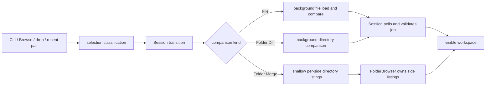

# Data flow and lifecycle

This guide follows a source from startup or user selection through asynchronous work to a visible result. For behavior guarantees, see the [SRS](../SRS.md); for module ownership, see the [architecture index](../ARCHITECTURE.md).

## Process and desktop startup

[`src/main.rs`](../../src/main.rs) parses native arguments with [`src/cli.rs`](../../src/cli.rs). Help, version, invalid arguments, and `--merge` are handled before creating the desktop window. A normal launch initializes local diagnostics and creates the eframe app. The command process remains attached to the window lifetime, which matters for callers that pass temporary input paths.

`VersusApp` in [`src/app.rs`](../../src/app.rs) owns the desktop-level composition. It holds the active `Session` plus window preferences and transient interaction state. The session owns the interactive view, folder browser and recent-pair state. UI actions that replace sources or switch comparison modes go through the session transition methods rather than directly replacing rendered data.

## Source-to-result flow

[`src/selection.rs`](../../src/selection.rs) classifies paths and configures native pickers. `Session` in [`src/app/session.rs`](../../src/app/session.rs) owns shared session state. `source.rs` handles source and mode transitions; `comparison.rs` starts file/folder workers and publishes their results; `navigation.rs` handles refresh and difference navigation; `merge_workspace.rs` coordinates editable workspace ownership. These modules start workers with captured inputs and cancellation tokens, and keep receivers with the state that requested them. Polling drains completed messages and checks the current session before publishing results. Replacing or dropping a job cancels or disconnects it so an obsolete request cannot become the current view.

File comparisons are loaded through core functions in [`src/core/file_view.rs`](../../src/core/file_view.rs). Folder Diff uses directory comparison and aligned tree construction in [`src/core/directory.rs`](../../src/core/directory.rs) and [`src/core/tree.rs`](../../src/core/tree.rs). Folder Merge intentionally begins with shallow metadata listings through [`src/core/lazy_directory.rs`](../../src/core/lazy_directory.rs); opening or expanding a path requests more data.

## Merge workspace lifetime

`InteractiveView` in [`src/app/interactive_view.rs`](../../src/app/interactive_view.rs) owns retained documents, active sides, pair history, asynchronous side loads, optional Run Diff jobs, and save coordination. Core editing state is represented by [`TwoWayWorkspace`](../../src/core/interactive.rs) and working files from [`src/core/work_files.rs`](../../src/core/work_files.rs). Navigating away from a document does not imply that its dirty working copy is discarded.

Folder Merge has an additional owner, `FolderBrowser` in [`src/app/folder_browser.rs`](../../src/app/folder_browser.rs). It owns each side's tree navigation and coordinates listing requests, staged comparison overlays, search state, and folder save work. Its capability submodules keep these operations grouped. `InteractiveView` remains the owner of the actual editable document contents.

## Freshness and publication

Treat worker output as a proposal. Before it changes visible state, identify the owner that requested it and the identity it captured (for example, source paths, document version, or query generation). The owner is responsible for deciding if that snapshot remains current. Search replacements follow the same rule: only complete current results can authorize a transaction, and transaction participants validate before any are published.

When debugging a stale view, inspect the lifecycle in this order: where the job starts, which state owns its receiver and cancellation token, how polling distinguishes current from retired work, and which fields invalidate cached presentation. Do not fix stale presentation by letting workers mutate shared UI state.
